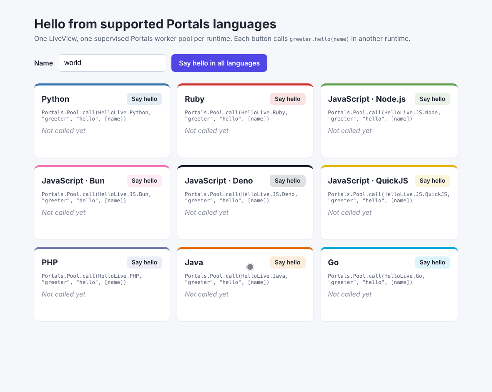

# Portals

Call Python, Ruby, JavaScript (Node.js, Bun, Deno or QuickJS), PHP, Java and
Go from Elixir through
supervised, pooled worker processes. Portals is a spiritual successor to
[ErlPort](https://github.com/hdima/erlport).

```elixir
{:ok, 2} = Portals.Pool.call(MyApp.Python, "text_tools", "word_count", ["hello world"])
```



*[`examples/hello_live`](https://github.com/Ziinc/portals/tree/main/examples/hello_live):
one LiveView page calling `greeter.hello(name)` in a supervised worker pool
per language, and per JavaScript runtime. The replies arrive independently,
as each runtime answers.*

Each worker is an ordinary program in its own language, running in its own
OS process under OTP supervision. A crash, hang or bad output in a worker
never takes down the BEAM. On top of plain calls you get:

- **Pools** with overflow workers, least-busy scheduling and bounded
  checkout.
- **Structured errors**: `{:error, %Portals.Error{}}` with the remote
  exception type, message and stack trace.
- **Callbacks** from the worker into Elixir, and **messages** from the
  worker to any PID.
- **Bidirectional streaming** with byte-credit backpressure in both
  directions.
- **Deadlines and cooperative cancellation**.
- **Exact protocol versioning**: every SDK speaks the same documented wire
  protocol and passes the same conformance suite.

## Install only the languages you use

Core `portals` has no worker SDKs. Each language is its own Hex package
that bundles its SDK. Nothing is installed from PyPI, RubyGems, npm,
Packagist, Maven or the Go module proxy.

| Language | Package | Guide |
|---|---|---|
| Python | [`portals_python`](https://hex.pm/packages/portals_python) | [Python guide](guides/languages/python.md) |
| Ruby | [`portals_ruby`](https://hex.pm/packages/portals_ruby) | [Ruby guide](guides/languages/ruby.md) |
| JavaScript (Node.js, Bun, Deno, QuickJS) | [`portals_javascript`](https://hex.pm/packages/portals_javascript) | [JavaScript guide](guides/languages/javascript.md) |
| PHP | [`portals_php`](https://hex.pm/packages/portals_php) | [PHP guide](guides/languages/php.md) |
| Java | [`portals_java`](https://hex.pm/packages/portals_java) | [Java guide](guides/languages/java.md) |
| Go | [`portals_go`](https://hex.pm/packages/portals_go) | [Go guide](guides/languages/go.md) |

```elixir
def deps do
  [
    {:portals_python, "~> 0.1.0"}
  ]
end
```

Every package is released in lockstep with `portals` at the same version,
so a worker SDK always speaks exactly the protocol the BEAM expects.

## Quick start (Python)

```python
# priv/python/text_tools.py
def word_count(text):
    return len(text.split())
```

```python
# priv/python/worker.py
from portals import Worker

Worker().run()
```

```elixir
# lib/my_app/application.ex
children = [
  {Portals.Pool,
   Portals.Python.worker_opts(
     script: Application.app_dir(:my_app, "priv/python/worker.py"),
     name: MyApp.Python,
     size: 4
   )}
]
```

```elixir
iex> Portals.Pool.call(MyApp.Python, "text_tools", "word_count", ["hello world"])
{:ok, 2}
```

To see all six languages in one app, run the
[`hello_live` example](https://github.com/Ziinc/portals/tree/main/examples/hello_live)
shown at the top of this page.

Start with [Getting started](guides/getting-started.md), then read the
guide for your language. Each one walks through a complete worker covering
calls, errors, callbacks, messages, streaming, deployment, gotchas and best
practices.

## Status

Pre-1.0. The protocol, Elixir API and six SDKs are implemented and tested.
Linux is the supported platform. See
[docs/prd.md](https://github.com/Ziinc/portals/blob/main/docs/prd.md) for the
roadmap.

## Repository layout

```text
lib/, test/            core `portals` (the Elixir side)
protocol/              the wire protocol spec, golden vectors, malformed fixtures
guides/                hexdocs guides, one page per language
packages/portals_<language>/
  lib/                 the Portals.<Language> launch helper
  priv/<language>/     the bundled worker SDK, with its own unit tests
  test/                the shared conformance suites run against that SDK
examples/hello_live/   a Phoenix LiveView app calling every language and JS runtime
bench/                 benchmarks against ETF, zerorpc, ErlPort and other codecs/transports
scripts/               test_all.sh, version.exs, release.sh, hex_dry_run.sh, publish_hex.sh
```

See [CONTRIBUTING.md](https://github.com/Ziinc/portals/blob/main/CONTRIBUTING.md)
for development and releases.

## License

MIT
